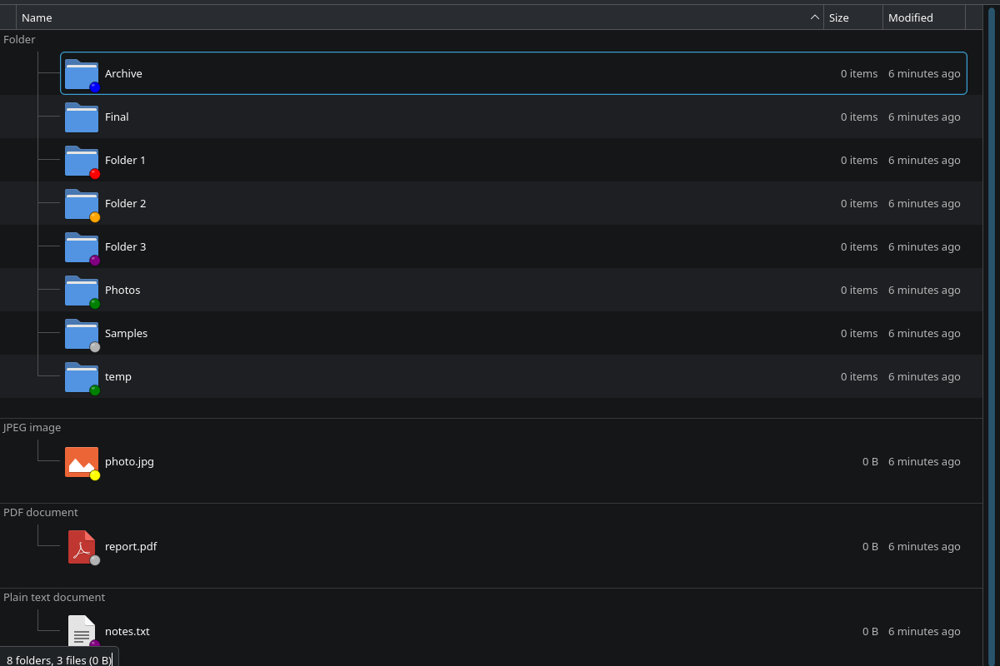
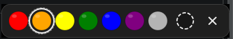

# Dolphin Color Tags

Color tags for files and folders in Dolphin: right-click an item, pick a color,
and a colored dot is drawn on its icon. Tags are plain extended attributes, so
they survive renames and moves and do not need a database or an indexer.



The palette, matching the reference picker:



Tested with Dolphin 26.08.2, KDE Frameworks 6.31 and Qt 6.12 on Plasma 6.8
(Wayland and X11); tag storage verified on ext4, btrfs and tmpfs.

## Features

- **Right-click → Color Tag** submenu with seven colors, *No Color* and
  *Choose Color…*.
- **Popup palette** in the style of One Commander: horizontal swatches, the
  current color ringed, keyboard support (`1`–`7`, `0`/`Del` for no color,
  arrow keys, `Enter`, `Esc`).
- **Colored dots on icons** for folders *and* files, in all Dolphin view modes.
  The dot size follows Dolphin's icon zoom level.
- **Live refresh**: a D-Bus signal repaints the badge immediately. No `F5`,
  no reopening the folder.
- **Multi-selection** with mixed-color detection and clear, per-file error
  reporting (read-only filesystems, permissions, unsupported filesystems).
- **CLI** (`colortag`) for scripts and keyboard shortcuts.
- No daemon, no database, no indexer.

## Requirements

- Dolphin / Plasma 6 with KF6 (this plugin is not compatible with KF5 / Plasma 5).
- A filesystem with user extended attributes: ext4, btrfs, xfs, f2fs, zfs…
  exFAT, FAT32 and most network shares do not support them.
- `qt6-svg` (so the installed SVG badge icons render).

## Install

### Arch Linux, CachyOS, Manjaro

```bash
sudo pacman -S --needed base-devel cmake ninja qt6-base qt6-svg kio
cd /path/to/dolphin-colortags
./scripts/install.sh          # installs to /usr, asks for sudo
```

Restart Dolphin afterwards:

```bash
killall dolphin
```

### Any distribution (manual build)

```bash
cmake -S . -B build -G Ninja \
      -DCMAKE_BUILD_TYPE=Release \
      -DCMAKE_INSTALL_PREFIX=/usr
cmake --build build
sudo cmake --install build
```

For distributions with a multiarch libdir, CMake's `GNUInstallDirs` picks the
right directory automatically. If your Qt plugins live somewhere unusual, set
`-DCOLORTAG_PLUGIN_DIR=<path relative to the prefix>`.

### User-local install (no root)

```bash
./scripts/install.sh --user
```

Qt does not search `~/.local` for plugins by default, so add the directory once:

```bash
mkdir -p ~/.config/environment.d
echo "QT_PLUGIN_PATH=$HOME/.local/lib/qt6/plugins" \
    > ~/.config/environment.d/90-dolphin-colortags.conf
```

Then log out and back in and restart Dolphin. A system-wide install avoids this
step.

## Usage

Right-click one or more files/folders → **Color Tag** → pick a color. The dot
appears on the icon immediately. *No Color* removes the tag; *Choose Color…*
opens the popup palette at the mouse cursor.

The submenu marks the shared color with a check mark. When a selection contains
different colors, no color is checked and the picker starts without a ring.

### Command line

```bash
colortag list                         # palette: id, label, hex
colortag get ~/Documents              # path <TAB> color (or "none")
colortag get --json ~/Documents
colortag set red ~/report.pdf         # one or more paths
colortag set none ~/report.pdf        # remove the tag
colortag clear ~/report.pdf
colortag pick ~/Downloads             # open the palette at the cursor
```

`set`/`clear` print a one-line summary, or a failure per path and exit 1. Use
`--quiet` to suppress the summary.

### Palette

| id | label | hex |
|----|-------|-----|
| `red` | Red | `#ff0000` |
| `orange` | Orange | `#ffa500` |
| `yellow` | Yellow | `#ffff00` |
| `green` | Green | `#008000` |
| `blue` | Blue | `#0000ff` |
| `purple` | Purple | `#800080` |
| `gray` | Gray | `#b3b3b3` |

## How it works

```
        context menu / picker                 icon badge
     ┌────────────────────────┐          ┌─────────────────────┐
     │ colortagaction.so      │          │ colortagoverlay.so  │
     │ KAbstractFileItemAction│          │ KOverlayIconPlugin  │
     │ Plugin                 │          │                     │
     └───────────┬────────────┘          └──────────┬──────────┘
                 │                                  │
                 │ setxattr("user.colortag")        │ getxattr()
                 ▼                                  ▼
          ┌──────────────────────────────────────────────┐
          │ file / folder   user.colortag = "red"        │
          └──────────────────────────────────────────────┘
                 │
                 │ D-Bus signal org.kde.ColorTag.Changed
                 └──────────────► overlay plugin emits overlaysChanged()
                                  Dolphin repaints without a reload
```

- The tag is stored in the `user.colortag` extended attribute as a short id
  (`red`, `orange`, …). No hidden files, no database.
- The overlay plugin maps the id to the theme icon `colortag-<id>`, installed
  into `hicolor/scalable/emblems`.
- The menu plugin writes the attribute and emits a session-bus signal; the
  overlay plugin listens for it and tells Dolphin which items changed.
- Dolphin's own *Assign Tags* (Baloo) and *Set Folder Icon* colors are separate
  features and are unaffected. You can use all of them together.

## Installed files

```
/usr/lib/qt6/plugins/kf6/overlayicon/colortagoverlay.so
/usr/lib/qt6/plugins/kf6/kfileitemaction/colortagaction.so
/usr/bin/colortag
/usr/share/icons/hicolor/scalable/emblems/colortag-*.svg
/usr/share/doc/dolphin-colortags/{README.md,LICENSE}
```

## Troubleshooting

**No dots appear.**
Check that the tag is really set and that the filesystem supports user xattrs:

```bash
setfattr -n user.colortag -v red /tmp/example
getfattr -n user.colortag /tmp/example
```

Then verify the plugin is in a directory Qt searches:

```bash
qmake6 -query QT_INSTALL_PLUGINS
ls "$(qmake6 -query QT_INSTALL_PLUGINS)/kf6/overlayicon"
```

Restart Dolphin; plugins are loaded at startup.

**No Color Tag menu entry.**
The action plugin must be in `.../plugins/kf6/kfileitemaction/`. Restart
Dolphin. Remote URLs (SFTP, SMB, archives) intentionally do not show the menu,
because extended attributes are local-only.

**Dots show as missing-image icons.**
`qt6-svg` is not installed, or the icons were installed after Dolphin started.
Install `qt6-svg` and restart Dolphin.

**“This filesystem does not support extended attributes”.**
The tag cannot be stored on exFAT/FAT32/NTFS-mounted-without-xattr or on some
network shares. Move the file to ext4/btrfs/xfs or skip tagging it.

**The picker appears at the wrong position on Wayland.**
Dolphin-parented popups (the normal path) are anchored correctly by KWin. The
standalone `colortag pick` creates its own anchor; some compositors may centre
it instead of placing it exactly at the cursor.

## Limitations

- Dolphin has no pluggable per-item color *column*. The tag is therefore shown
  as a badge in the corner of the icon: 8 px in the Details view with 16 px
  icons, 16 px with 48 px icons. Increase the icon size for a more prominent
  dot.
- One color per item.
- Local files only; tags on remote URLs are not supported.
- Copying a file does not necessarily copy extended attributes (`cp -a` does).
  Renaming or moving within the same filesystem keeps the tag.
- The plugin is loaded by Dolphin; after installing or updating it, restart
  Dolphin.
- Not tested inside Flatpak/Snap sandboxes.

## Uninstall

```bash
./scripts/uninstall.sh          # or --user
```

Tags in `user.colortag` are left in place; remove them with `setfattr -x`.

## Development

```bash
cmake -S . -B build -G Ninja -DCMAKE_BUILD_TYPE=Debug
cmake --build build
ctest --test-dir build --output-on-failure
```

The build tree contains a ready-to-use plugin layout for testing without
installing:

```bash
QT_PLUGIN_PATH="$PWD/build/plugins" dolphin --new-window ~/some/folder
```

Regenerate the badge SVGs after changing the palette:

```bash
./scripts/generate-icons.py
```

KDE Store packaging (listing text, screenshots, release tarball) lives in
[`packaging/kde-store/`](packaging/kde-store/README.md).

## License

GPL-2.0-or-later. See [LICENSE](LICENSE).
